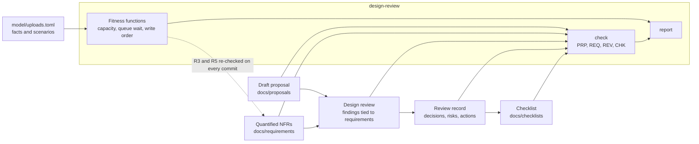

# Architecture: the design review and its toolkit

Component names match the lesson's diagram ("A design review that improves without blocking"): **Draft proposal**, **Quantified NFRs**, **Design review** and **Review record**. The toolkit checks each box and the arrows between them.

## Components and what each owns

| Component | Where it lives | What it owns |
| --- | --- | --- |
| **Draft proposal** | [docs/proposals/uploads-service-draft-1.md](docs/proposals/uploads-service-draft-1.md); rules in `domain/proposal.py` | What a reviewer needs to hold on to: datastore, external calls, scaling, a diagram, and the author's own doubts. |
| **Quantified NFRs** | [docs/requirements/uploads-nfrs.md](docs/requirements/uploads-nfrs.md); rules in `domain/requirements.py` | Each requirement as a number and a way to check it. |
| **Design review** | [docs/reviews/review-2026-10-22-uploads-service.md](docs/reviews/review-2026-10-22-uploads-service.md); rules in `domain/review.py` | Verdicts per requirement, findings tied to a requirement and classed, the disagreement. |
| **Review record** | the decisions, accepted risks and action items sections of the same file | Owners and dates; what is settled and what is open. |
| **Fitness functions** | `domain/capacity.py`, `queue_model.py`, `durability.py`, `fitness.py`; scenarios in [model/uploads.toml](model/uploads.toml) | The review's arithmetic, re-run on every commit. |
| **Checklist** | [docs/checklists/design-checklist.md](docs/checklists/design-checklist.md); rules in `domain/checklist.py` | Questions an author answers before the review, covering every category a finding fell in. |
| **Use cases** | `application/check_documents.py`, `reporting.py` | Which files are checked against which, and how reports are formatted. |
| **Command line** | `interfaces/cli.py` | `check`, `fitness`, `report`, exit codes (0 ok, 1 findings or a surprising scenario, 2 bad configuration). |

## Pattern: ports and adapters over rule functions and a small model

Rules are pure functions from a parsed document to findings. The fitness functions are pure functions from the model to a verdict. The use case asks for a `DocumentStore`, a `DocumentReader` and a `ModelSource`; the file system, the Markdown parser and the TOML loader implement them, and tests use an in-memory store. This fits because the review's judgments are few and its arithmetic is where a mistake hides, so the arithmetic is isolated and testable without files.

## Data flow

Drawn versions of this figure and of the walk-through: [the architecture](docs/diagrams/architecture.svg) and [one run](docs/diagrams/flow.svg).

### One run, step by step (`make run`)

1. `check` reads every requirements document, then the proposal, then each `review-*.md` file, and the checklist.
2. Each requirement goes through REQ001 to REQ004. The proposal goes through PRP001 to PRP004.
3. Each review is matched with the requirements file named in its header. The requirements it cites must equal that file's targets (REV002); every one needs a verdict (REV003), and at least one reason must show arithmetic (REV004).
4. Findings are checked one by one: a requirement of this review or `none`, a class, taste said aloud (REV005, REV006); then the whole list (REV008), the record's parts (REV009 to REV011) and the disagreement (REV012). A non-met verdict with no finding is reported (REV007).
5. The checklist is checked against the primary requirements and the performance review's findings (CHK001 to CHK003).
6. `fitness` loads `model/uploads.toml`, computes the average rate (3.89 a second), runs each worker count through the queue model for the 216,000-second weekend, and each write order through the crash-point check. It prints the table and exits 1 if any scenario gave a verdict other than the recorded one.
7. `report` writes both results to `build/report.md`.

## Decisions and trade-offs

- **Requirements by id, with the target copied into the review.** The review repeats each requirement's target so it reads alone, and REV002 checks the copy against the requirements document. A silent edit of a number in either place fails the check, which is what happens when a review and its requirements drift apart.
- **A scenario table with expected verdicts, not asserts.** The draft is supposed to fail; recording "fail" as the expectation keeps the evidence in the run's output instead of hiding it in a test.
- **A fluid queue, not a discrete-event simulator.** The question is whether the backlog built in a burst drains within 30 seconds for 95 percent of photos; the fluid model answers it in a loop of 216,000 additions and divisions, deterministic and easy to explain. A discrete-event model with random arrivals would add a seed and a variance to argue about.
- **The mean is preserved.** The burst is added by lowering the quiet rate, so the model cannot be accused of inventing load beyond the lesson's 1.2 million photos.
- **Crash-point enumeration for durability.** Writes are few, so every prefix of the steps can be tried. The rule is the lesson's: once the seller has been told yes, both the row and the file must exist. Orphan files are reported separately because they are a cost finding, not a loss.
- **Two review records, one linter.** Both lenses use the same format and rules, which is what makes them comparable.

## Failure modes the lesson teaches, and how the code shows them

| Mistake (lesson, "Common mistakes") | Rule that catches it |
| --- | --- |
| Concerns that point to no requirement | REV005 |
| Requirements written as adjectives | REQ001, REQ002 |
| Calling everything must-fix | REV008 |
| No owners and dates on actions | REV010, REV011 |
| A disagreement the reviewer always wins | REV012 |
| Reviewing before you have the numbers | REV004 (the arithmetic must be shown) and the fitness functions |

## Limits of the teaching build against a production one

- The queue model has no autoscaler delay or random arrivals. A production check would replay recorded traffic and measure the autoscaler.
- Cost is not modeled.
- The linter checks structure and consistency. It cannot tell a wrong verdict from a right one, or a preference from a requirement in disguise.
- One system, one proposal. A team would keep one requirements file per system and run the checks in the pull request that changes it.

## How to extend it

Add a requirement: a row in the requirements document and a use of it in the review. Add a fitness function: a pure function in `domain/`, a section in `model/uploads.toml`, a field in `FitnessReport`, and a row in the table. Add a review: copy `templates/review-template.md` to `docs/reviews/review-<date>-<system>.md` and point its `Requirements file` header at the right document.
